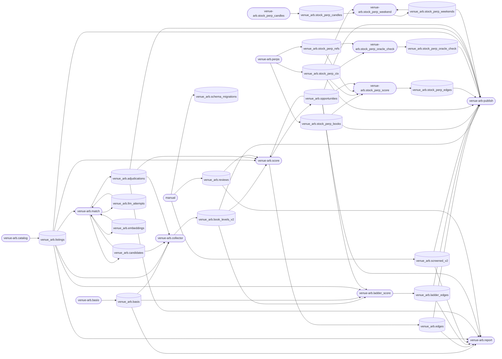

<!-- generated by tools/catalog.py from datasets.toml; edit the declarations, then `just catalog-docs` -->

# Datasets: venue-arb

| Dataset | Engine | Producer | Consumers | Cadence | Freshness | Floor | Description | Runbook |
|---|---|---|---|---|---|---|---|---|
| `venue_arb.book_levels_v2` | clickhouse | `venue-arb.collector` | `venue-arb-publish`, `venue-arb.ladder_score`, `venue-arb.score` | 1m | 20m | 1000 | Order-book levels of every matched market, one row per snapshot per side per level (60 s snapshots) | `docs/runbooks/venue-arb.md#venue-arbcollector` |
| `venue_arb.basis` | clickhouse | `venue-arb.basis` | `venue-arb.collector`, `venue-arb.ladder_score`, `venue-arb.report` | 1h | 72h | 0 | Kalshi BRTI settle vs Binance candle close per (asset, settlement instant); lags by the Binance archive's publication delay | `docs/runbooks/venue-arb.md#venue-arbbasis` |
| `venue_arb.edges` | clickhouse | `venue-arb.score` | `venue-arb-publish`, `venue-arb.report` | 1h | 2h | 1 | Executable cross-venue edge per exact pair, direction and book snapshot | `docs/runbooks/venue-arb.md#venue-arbscore` |
| `venue_arb.ladder_edges` | clickhouse | `venue-arb.ladder_score` | `venue-arb-publish`, `venue-arb.report` | 1h | 24h | 0 | Edge per crypto ladder pair (Kalshi strike vs Polymarket up/down), direction and book snapshot | `docs/runbooks/venue-arb.md#venue-arbladder_score` |
| `venue_arb.screened_v2` | clickhouse | `manual` | `venue-arb-publish`, `venue-arb.report` |  | manual |  | Top-of-book screen of exact pairs at aligned snapshots (run by hand: python -m venue_arb.flows.screened) | `docs/runbooks/venue-arb.md` |
| `venue_arb.stock_perp_books` | clickhouse | `venue-arb.perps` | `venue-arb-publish`, `venue-arb.stock_perp_score` | 1m | 20m | 100 | Hyperliquid stock-perp order-book levels, one row per snapshot per side per level | `docs/runbooks/venue-arb.md#venue-arbperps` |
| `venue_arb.stock_perp_candles` | clickhouse | `venue-arb.stock_perp_candles` | `venue-arb.stock_perp_weekend` | 168h | 192h | 1 | Hourly candles and funding per stock perp: the last 4 days every Monday (so Monday to Thursday is not covered), 60 days at deploy from stock_perp_backfill | `docs/runbooks/venue-arb.md#venue-arbstock_perp_candles` |
| `venue_arb.stock_perp_ctx` | clickhouse | `venue-arb.perps` | `venue-arb-publish`, `venue-arb.stock_perp_oracle_check`, `venue-arb.stock_perp_score`, `venue-arb.stock_perp_weekend` | 1m | 20m | 100 | Per-perp context each snapshot: mark, oracle, mid, funding, premium, open interest, day volume | `docs/runbooks/venue-arb.md#venue-arbperps` |
| `venue_arb.stock_perp_refs` | clickhouse | `venue-arb.perps` | `venue-arb.stock_perp_oracle_check`, `venue-arb.stock_perp_score` | 1m | 20m | 100 | Stock reference quotes (Schwab) for perps with a stock leg, each snapshot; daily opens from the backfill | `docs/runbooks/venue-arb.md#venue-arbperps` |
| `venue_arb.stock_perp_edges` | clickhouse | `venue-arb.stock_perp_score` | `venue-arb-publish` | 1h | 2h | 1 | Perp vs stock basis net of fees, spread, funding and borrow, per symbol, direction and snapshot | `docs/runbooks/venue-arb.md#venue-arbstock_perp_score` |
| `venue_arb.stock_perp_oracle_check` | clickhouse | `venue-arb.stock_perp_oracle_check` | `venue-arb-publish` | 24h | 120h | 0 | Daily oracle vs stock quote deviation per symbol and session segment (weekday evenings, for that trading day) | `docs/runbooks/venue-arb.md#venue-arbstock_perp_oracle_check` |
| `venue_arb.listings` | postgres | `venue-arb.catalog` | `venue-arb-publish`, `venue-arb.collector`, `venue-arb.ladder_score`, `venue-arb.match`, `venue-arb.report`, `venue-arb.score` | 1h | 2h | 1 | Open markets on both venues with rules and labels; last_seen refreshed every catalog run, so volume counts listings seen in the window, not rows written | `docs/runbooks/venue-arb.md#venue-arbcatalog` |
| `venue_arb.candidates` | postgres | `venue-arb.match` | `venue-arb.collector`, `venue-arb.match` | 1h | 24h | 0 | Candidate cross-venue pairs from embedding similarity and rules, one row per pair | `docs/runbooks/venue-arb.md#venue-arbmatch` |
| `venue_arb.adjudications` | postgres | `venue-arb.match` | `venue-arb-publish`, `venue-arb.collector`, `venue-arb.report`, `venue-arb.score` | 1h | 24h | 0 | Pair verdict (relation, yes mapping, differences, confidence) per candidate pair version and prompt version | `docs/runbooks/venue-arb.md#venue-arbmatch` |
| `venue_arb.llm_attempts` | postgres | `venue-arb.match` | `venue-arb.match` | 1h | 24h | 0 | Every LLM adjudication attempt with outcome, error type and cost (retry budget and spend) | `docs/runbooks/venue-arb.md#venue-arbmatch` |
| `venue_arb.embeddings` | postgres | `venue-arb.match` | `venue-arb.match` |  | manual |  | Listing text embedding per market version (no timestamp column, so lineage only) | `docs/runbooks/venue-arb.md#venue-arbmatch` |
| `venue_arb.opportunities` | postgres | `venue-arb.score` | `venue-arb-publish`, `venue-arb.ladder_score`, `venue-arb.report`, `venue-arb.score`, `venue-arb.stock_perp_score` |  | manual |  | Arbitrage episodes (start, end, max edge, capacity); also written by ladder_score and stock_perp_score (source column). Rows only when an edge exists, so lineage only | `docs/runbooks/venue-arb.md#venue-arbscore` |
| `venue_arb.reviews` | postgres | `manual` | `venue-arb.report`, `venue-arb.score` |  | manual |  | Hand labels of adjudicated pairs (python -m venue_arb.flows.review_cli) | `docs/runbooks/venue-arb.md` |
| `venue_arb.stock_perp_weekends` | postgres | `venue-arb.stock_perp_weekend` | `venue-arb-publish`, `venue-arb.stock_perp_weekend` | 168h | 192h | 0 | Weekend perp prices vs the Monday open per symbol and weekend, computed Monday after the open | `docs/runbooks/venue-arb.md#venue-arbstock_perp_weekend` |
| `venue_arb.schema_migrations` | postgres | `manual` |  |  | manual |  | Applied migrations (db/migrate.py) |  |

