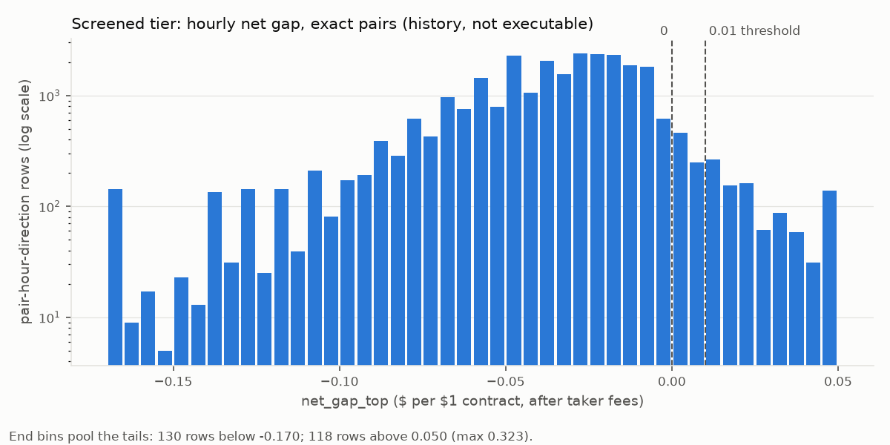
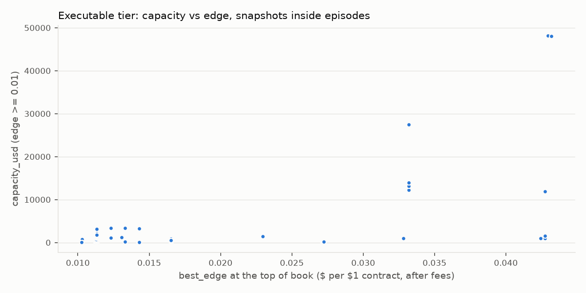

# Do exact Kalshi-Polymarket matches carry arbitrage? Research note v1

Generated 2026-10-22 15:41 UTC by `python -m venue_arb.report.note`. Every number below is computed from the tables named in Method at generation time; the queries are listed at the end. This is v1: the executable tier covers only the snapshots collected so far, and the note is re-run once about four weeks of snapshots exist.

## Question

When Kalshi and Polymarket list the same contract, do their prices leave money on the table after taker fees and order-book depth? Headline perspective: arbitrage that someone, somewhere could execute (both legs tradable by some eligible participant; which jurisdictions each venue admits is itself unverified, see `docs/venues.md`), with a US-only cut alongside.

**Short answer so far** (each figure is restated with its source under Results):

- Executable tier: 13 opportunity episodes in 69.1 h of snapshots (too short to conclude anything); the largest top-of-book edge after fees was 0.0432 per $1 against a 0.01 threshold.
- Screened tier (history, not executable): median hourly net gap -0.032; 3.5% of rows reached 0.01 (a count biased in both directions: the 1-contract fee ceiling pushes it down, the mid/last Polymarket price pushes it up; see Limits), 31.4% of those in a pair's first 7 days.
- Same-instant crypto ladders (model-free, a separate tier): 2 of 1,469,130 admissible cross-strike checks (0.0%, over 21 counted hours) had an executable edge >= 0.01 after fees with the strikes at least the basis bound apart; 0 episodes in 47.6 h of ladder snapshots (too short to conclude anything); largest top-of-book edge 0.0178 per $1.

## Data and window

- Venues: Kalshi and Polymarket International (public read endpoints only; no orders).
- Pairs: 15 eligible exact pairs at generation time (15 human-reviewed, 0 not), Kalshi series: `KXFEDDECISION`.
- Screened tier: hourly, 2026-06-18 00:00 UTC to 2026-10-19 20:00 UTC; 27,043 rows (13,751 pair-hours, up to two directions each) over 9 pairs.
- Executable tier: order-book snapshots at a 60 s cadence, 2026-10-19 18:33 UTC to 2026-10-22 15:37 UTC (69.1 h); 62,099 aligned pair-snapshots (124,198 rows, one per direction) over 15 pairs.
- Ladder tier: order-book snapshots of same-instant crypto ladders at a 60 s cadence, 2026-10-20 15:10 UTC to 2026-10-22 14:48 UTC (47.6 h); 88 ladders (BTC 44, ETH 44), 5951 Kalshi and 1576 Polymarket strikes with scored rows.
- Tier scope: both pair tiers keep every pair whose latest prompt-v3 adjudication is `exact` and that has no `wrong`/`unsure` review of that verdict (reviews made against an older prompt's verdict are ignored), whether or not it is open now (a closed pair's history is still evidence). Pairs are Kalshi-Polymarket market pairs.
  - Screened: 9 pairs in scope (9 currently eligible, 0 closed, 0 open but not currently eligible); excluded pairs with rows in the table: none.
  - Executable: 15 pairs in scope (15 currently eligible, 0 closed, 0 open but not currently eligible); excluded pairs with rows in the table: none.

| Kalshi ticker | Polymarket market | LLM confidence | Human review | Closes |
|---|---|---|---|---|
| KXFEDDECISION-26DEC-C25 | `0xf17ad24e...` | 1.00 | correct | 2026-12-09 23:59 UTC |
| KXFEDDECISION-26DEC-C26 | `0xb9aee520...` | 1.00 | correct | 2026-12-09 23:59 UTC |
| KXFEDDECISION-26DEC-H0 | `0x723822eb...` | 1.00 | correct | 2026-12-09 23:59 UTC |
| KXFEDDECISION-26DEC-H25 | `0x8a419661...` | 1.00 | correct | 2026-12-09 23:59 UTC |
| KXFEDDECISION-26DEC-H26 | `0xa5f8a445...` | 1.00 | correct | 2026-12-09 23:59 UTC |
| KXFEDDECISION-26OCT-C25 | `0x9cf563d7...` | 1.00 | correct | 2026-10-29 03:59 UTC |
| KXFEDDECISION-26OCT-C26 | `0xa69ef420...` | 1.00 | correct | 2026-10-29 03:59 UTC |
| KXFEDDECISION-26OCT-H0 | `0xdf9bf27e...` | 1.00 | correct | 2026-10-29 03:59 UTC |
| KXFEDDECISION-26OCT-H25 | `0x12aa13b3...` | 1.00 | correct | 2026-10-29 03:59 UTC |
| KXFEDDECISION-26OCT-H26 | `0xde5d75ab...` | 1.00 | correct | 2026-10-29 03:59 UTC |
| KXFEDDECISION-27JAN-C25 | `0x0bbe79a9...` | 1.00 | correct | 2027-01-28 04:59 UTC |
| KXFEDDECISION-27JAN-C26 | `0xfd0fb47d...` | 1.00 | correct | 2027-01-28 04:59 UTC |
| KXFEDDECISION-27JAN-H0 | `0xf6e7c89e...` | 1.00 | correct | 2027-01-28 04:59 UTC |
| KXFEDDECISION-27JAN-H25 | `0x50642b28...` | 1.00 | correct | 2027-01-28 04:59 UTC |
| KXFEDDECISION-27JAN-H26 | `0x21cd6160...` | 1.00 | correct | 2027-01-28 04:59 UTC |

## Method

**What counts as exact.** The two Yes outcomes pay in the same states of the world: same event, same outcome definition, same decision date and same resolving authority. Trading close times and the wording of the source pages do not count as differences. Rare edge clauses (for example a cancelled meeting, or an odd-size rate move rounded up) keep a pair exact but are recorded as tail risks and listed under Results. **Near** means the Yes outcomes overlap but differ (window, threshold or authority). **Different** means the Yes outcomes are mutually exclusive or disjoint, including different outcome brackets of the same meeting (hold vs +25 bp, exactly 25 vs more than 25, +25 vs 50+). Every Fed target change since 1989 has been a multiple of 25 bp, so "more than 25 bp" and "50 bp or more" are the same outcome set; an off-grid move is a tail risk. Adjudication was by a deterministic rule (rule:fed-v1 (prompt v3)).

**Eligibility.** The latest adjudication at the listings' current versions says `relation = 'exact'`, and either confidence >= 0.8 with no review, or a human review labeled `correct`; any `wrong` or `unsure` review excludes the pair. The adjudication must be at the current prompt version, and only reviews made of that verdict count. Both listings must be open and seen in the last 2 hours.

**Two pair tiers, never combined** (the ladder tier below is a third, also kept apart).

- *Screened* (`venue_arb.screened_v2`): Kalshi's hourly candle close ask (Yes ask, or 1 - Yes bid for No), taken at the candle's `end_period_ts`, the instant Kalshi documents the close quote for, against the Polymarket price-history print nearest that instant (within 30 minutes; none, no row) for the opposite leg, minus one contract's taker fee on each leg: `net_gap_top = 1 - k_price - pm_price - fees`. Hours where Kalshi's book side was empty give no row. Polymarket history is a traded/mid price, not an ask, so this tier says where gaps tended to appear, not that they were executable. (`venue_arb.screened`, v1, paired each Kalshi close with the Polymarket print about an hour earlier and is no longer read.)
- *Executable* (`venue_arb.edges`, `venue_arb.opportunities`): our own order-book snapshots. A Kalshi snapshot is aligned with the nearest Polymarket snapshot within 30 s. Both ask ladders are walked together; `best_edge` is the top-of-book edge after fees and `capacity_usd` the dollars spent on both legs while the marginal edge stays >= 0.01. Snapshots are taken every 60 s; a gap over 150 s between consecutive snapshots breaks an episode's run.

**Edge and the episode threshold.** Prices come from our own snapshots of both venues' order books, taken every 60 seconds, not from last trades or midpoints. For each exact pair we buy Yes on one venue and No on the other, walking up both venues' lists of offers slice by slice and paying each venue's taker fee, so the edge is what is left per $1 contract after the cost of trading. An episode is a stretch where that net edge is at least 1¢, at least $100 can be filled, and both hold in at least 2 consecutive snapshots.

**Fees** (entries dated 2026-10-19, sources in `docs/venues.md`). Kalshi taker: `0.07 x C x P x (1-P)` times the series' `fee_multiplier` (read from the API), rounded up to the cent; the 0.07 coefficient is secondhand (see Limits). Polymarket taker: `C x rate x (P(1-P))^exponent` read from each market's own `feeSchedule` (here: `{"exponent": 1, "rate": 0, "rebateRate": 0, "takerOnly": true}`), no rounding.

**Transfer cost** (an assumption, not a venue number): $10 fixed + 10 bps per round trip of capital between venues. It is reported as a sensitivity count, not subtracted from the headline edge.

**Same-instant crypto ladders (model-free).** A third tier, scored from our own order books like the executable tier and never combined with it.

- *Same-instant rule.* Kalshi `KXBTCD`/`KXETHD` "$X or above" contracts (and the "or above" tails of the `KXBTC`/`KXETH` range events) are paired with Polymarket "Bitcoin/Ethereum above X" contracts (hourly ladders, and the daily ladder at noon ET) only when both settle at the same instant H (Kalshi's `close_time` is its settlement instant). Pairs whose settlement instants differ (gapped pairs) are excluded: whether they pay in every state depends on how far the price can move between the two instants, which needs a volatility model, and a reader can reject a model. They cannot serve as proof, so they are not scored here.
- *Settlement sources.* Kalshi: the simple average of the 60 seconds of CF Benchmarks' BRTI before H. Polymarket hourly: the close of the Binance BTC/USDT (ETH/USDT) 1 hour candle ending at H; Polymarket daily: the Binance 1 minute candle closing at 12:00 ET (the same close as the 1 hour candle ending then).
- *Threshold normalization* (from the rule text, `venue_arb/matching/crypto_rule.py`). Kalshi "$X or above" is Yes iff BRTI > X - 0.01 (ticker `T{X-0.01}`), so its strike is a = X - 0.01. Polymarket hourly and daily "above X" are Yes iff the Binance close > X (strict), so b = X. Polymarket daily "greater than X" is the top bracket of a range ladder whose boundary values go to the higher bracket, so it is Yes iff the close >= X and is normalized to b = X - 0.01 like Kalshi.
- *Why a spread can pay in every state.* On one index, P(S > a) >= P(S > b) whenever a <= b. Here the legs settle on two indices; let diff = BRTI - Binance at H. `k_yes_pm_no` (buy Kalshi Yes at a and Polymarket No at b) pays $0 only if BRTI <= a and Binance > b, which needs Binance - BRTI > b - a. `pm_yes_k_no` (Polymarket Yes at b and Kalshi No at a) pays $0 only if Binance <= b and BRTI > a, which needs BRTI - Binance > a - b. In every other state at least one leg pays $1.
- *Basis bounds* (`venue_arb.basis`: one row per asset and hour with BRTI's settle and the Binance candle close). Directional: `up` = how far BRTI rose above Binance, `down` = how far it fell below, each the 0.999 nearest-rank quantile of the trailing 30 days of hourly diffs, rounded up to $1. An asset with fewer than 24 hours has no bound and its ladders are not scored. The scoring flow computes the bounds as of each run, so stored rows can carry slightly different bounds from the table below, which is as of generation time:

| Asset | Hours (n) | up ($) | down ($) | Mean diff | Min diff | Max diff |
|---|---|---|---|---|---|---|
| BTC | 689 | 182 | 152 | -$52.97 (-6.4 bps) | -$151.18 | +$181.59 |
| ETH | 689 | 6 | 7 | -$1.65 (-6.6 bps) | -$6.72 | +$5.83 |

On average BRTI sits below Binance at the settle (BTC -$52.97 (-6.4 bps), ETH -$1.65 (-6.6 bps)), so the two venues' settle prices differ even when nothing moves; that is why same-strike pairs are not arbitrage.

- *Admissible checks.* Both venues list Bitcoin and Ethereum price ladders, but they settle on different price indexes, so only ladders that settle at the same instant are compared. A Kalshi strike against a different Polymarket strike counts only when the gap between the two strikes is at least the 99.9th percentile of the difference between the two settlement indexes over the past 30 days. Then at least one leg pays out in every state, as long as the indexes stay within that measured range. In the stored terms, `k_yes_pm_no` needs b - a >= down and `pm_yes_k_no` needs a - b >= up; these checks are stored as `kind = 'arb'`.
- *Near-exact same-strike pairs* (|a - b| <= $1 after normalization, e.g. Kalshi `T81499.99` vs Polymarket "above 81,500") are classified first, scored in both directions and stored as `kind = 'near_exact'`. Both legs lose if the settle falls between the two indices, a band up to `down` (`k_yes_pm_no`) or `up` (`pm_yes_k_no`) dollars wide, so they are reported separately with that exposure and never as arbitrage, and they form no episodes.
- *Pruning and the denominator.* Per Kalshi strike and direction only the 2 nearest admissible Polymarket strikes are scored and stored: the cost is Kalshi Yes(a) + Polymarket No(b), and No(b) rises with b, so the nearest admissible strike is the cheapest when books are monotone (the second is margin for books that are not). Every admissible check, scored or pruned, is counted by the scoring flow and recorded as the `ladder_admissible_checks` qa result; that count is the denominator. A check is one strike pair, one direction, one aligned snapshot. Each hourly run rescores the last 3 h but counts only snapshots in the 1-hour clock bucket before its start (the bucket is recorded with the count), so successive runs count disjoint hours and their sum counts each snapshot once; a manual re-run of a bucket is kept once. The numerator is restricted to the same hours. A failed or skipped run leaves its hour out of both, so the share covers counted hours only; tests record under a separate qa pipeline and never enter it.
- *Execution rules* are the executable tier's: ask ladders walked together with taker fees on both legs, snapshots aligned within 30 s, edge threshold 0.01, the same episode definition. Only snapshots strictly before H count (from H on, the outcome is being fixed). Episodes are stored in `venue_arb.opportunities` with `source = 'ladder'`; every pair-tier query reads `source = 'pair'` only.
- *Reading `venue_arb.ladder_edges` directly:* rows keep the bounds they were scored under (`basis_up`, `basis_down`), so filter by `kind` and by those stored bounds, not by today's bounds.

## Results

### Screened tier (history; not arbitrage)

- Rows (pair x hour x direction): 27,043.
- `net_gap_top` p50 -0.032, p90 -0.006, max 0.323.
- Rows with `net_gap_top > 0`: 1,672 (6.2%); >= 0.01: 958 (3.5%). Both counts are biased in both directions: the 1-contract Kalshi fee is ceiled to the cent, which can understate a net gap by up to ~$0.01 (biases the counts down), and Polymarket's history is a mid/last price rather than an ask (biases them up). Which effect dominates is not known; see Limits.
- Of the rows >= 0.01, 301 (31.4%) fall in their pair's first 7 days of screened history, which hold 7.1% of all rows.

| Kalshi ticker | First hour | Rows | p50 net | Max net | Rows >= 0.01 |
|---|---|---|---|---|---|
| KXFEDDECISION-26DEC-C25 | 2026-07-30 02:00 UTC | 2,562 | -0.019 | 0.059 | 123 |
| KXFEDDECISION-26DEC-H0 | 2026-07-30 01:00 UTC | 2,534 | -0.036 | 0.054 | 81 |
| KXFEDDECISION-26DEC-H25 | 2026-07-30 02:00 UTC | 3,050 | -0.044 | 0.148 | 61 |
| KXFEDDECISION-26OCT-C25 | 2026-06-18 01:00 UTC | 3,269 | -0.018 | 0.323 | 115 |
| KXFEDDECISION-26OCT-H0 | 2026-06-18 01:00 UTC | 4,704 | -0.037 | 0.258 | 149 |
| KXFEDDECISION-26OCT-H25 | 2026-06-18 00:00 UTC | 4,540 | -0.036 | 0.308 | 168 |
| KXFEDDECISION-27JAN-C25 | 2026-07-30 02:00 UTC | 2,362 | -0.030 | 0.223 | 183 |
| KXFEDDECISION-27JAN-H0 | 2026-07-30 02:00 UTC | 2,472 | -0.047 | 0.113 | 50 |
| KXFEDDECISION-27JAN-H26 | 2026-07-30 02:00 UTC | 1,550 | -0.017 | 0.255 | 28 |



*Screened tier. Distribution of `net_gap_top` over all 27,043 rows. The x-axis is clipped to the 0.5th-99.5th percentile, rounded out to the 0.005 bin grid (threshold kept in view); rows outside are pooled into the end bins and counted in the chart's footer line. Log y-axis so the thin positive tail is visible.*

### Executable tier (order books)

- Aligned pair-snapshots: 62,099; with capacity > 0 in either direction (marginal edge >= 0.01 at the top): 3,937 (6.3%).
- `best_edge` (per row, both directions) p50 -0.0084, max 0.0432.
- Opportunity episodes: 13. Duration median 58.0 min, max 840.0 min; median capacity $396, max $13,242; median annualized edge 8.5%.
- Episodes still positive after the transfer assumption: 4 of 13 (approximate and optimistic: it credits each episode's maximum edge on all of its median capacity, against `transfer_cost_usd`).

| Kalshi ticker | Snapshots | Max best_edge | Snapshots with capacity > 0 |
|---|---|---|---|
| KXFEDDECISION-26DEC-C25 | 4,140 | 0.0023 | 0 |
| KXFEDDECISION-26DEC-C26 | 4,140 | -0.0057 | 0 |
| KXFEDDECISION-26DEC-H0 | 4,140 | 0.0272 | 227 |
| KXFEDDECISION-26DEC-H25 | 4,140 | 0.0165 | 714 |
| KXFEDDECISION-26DEC-H26 | 4,140 | 0.0143 | 2,476 |
| KXFEDDECISION-26OCT-C25 | 4,139 | -0.0077 | 0 |
| KXFEDDECISION-26OCT-C26 | 4,140 | n/a | 0 |
| KXFEDDECISION-26OCT-H0 | 4,140 | 0.0048 | 0 |
| KXFEDDECISION-26OCT-H25 | 4,140 | 0.0043 | 0 |
| KXFEDDECISION-26OCT-H26 | 4,140 | -0.0077 | 0 |
| KXFEDDECISION-27JAN-C25 | 4,140 | 0.0083 | 0 |
| KXFEDDECISION-27JAN-C26 | 4,140 | -0.0047 | 0 |
| KXFEDDECISION-27JAN-H0 | 4,140 | 0.0429 | 510 |
| KXFEDDECISION-27JAN-H25 | 4,140 | 0.0432 | 10 |
| KXFEDDECISION-27JAN-H26 | 4,140 | -0.0027 | 0 |



*Executable tier. Each dot is one snapshot inside one of the 13 episodes: edge at the top of book against dollars executable before the edge falls below 0.01.*

### Jurisdiction cut (US)

- Episodes executable within the US: 0 of 13. Polymarket International is the only Polymarket venue scored, and it blocks US trading (US_EXECUTABLE = {'kalshi': True, 'polymarket': False}, docs/venues.md geoblock entry), so no pair has both legs executable from the US.

### Contract-term differences (tail risk)

Clauses recorded as rare edge cases that keep each eligible pair exact (latest adjudication at current versions): LLM-written for LLM-judged pairs, a fixed text for rule-judged Fed pairs. Quoted verbatim, not human-reviewed.

- **KXFEDDECISION-26DEC-C25**
  - An off-grid (non-25 bp) move — none since Oct 1989 — could resolve differently: Polymarket rounds odd moves up to the next bracket, Kalshi thresholds are strict
  - A cancelled or rescheduled meeting resolves under each venue's own fallback rules
- **KXFEDDECISION-26DEC-C26**
  - An off-grid (non-25 bp) move — none since Oct 1989 — could resolve differently: Polymarket rounds odd moves up to the next bracket, Kalshi thresholds are strict
  - A cancelled or rescheduled meeting resolves under each venue's own fallback rules
- **KXFEDDECISION-26DEC-H0**
  - An off-grid (non-25 bp) move — none since Oct 1989 — could resolve differently: Polymarket rounds odd moves up to the next bracket, Kalshi thresholds are strict
  - A cancelled or rescheduled meeting resolves under each venue's own fallback rules
- **KXFEDDECISION-26DEC-H25**
  - An off-grid (non-25 bp) move — none since Oct 1989 — could resolve differently: Polymarket rounds odd moves up to the next bracket, Kalshi thresholds are strict
  - A cancelled or rescheduled meeting resolves under each venue's own fallback rules
- **KXFEDDECISION-26DEC-H26**
  - An off-grid (non-25 bp) move — none since Oct 1989 — could resolve differently: Polymarket rounds odd moves up to the next bracket, Kalshi thresholds are strict
  - A cancelled or rescheduled meeting resolves under each venue's own fallback rules
- **KXFEDDECISION-26OCT-C25**
  - An off-grid (non-25 bp) move — none since Oct 1989 — could resolve differently: Polymarket rounds odd moves up to the next bracket, Kalshi thresholds are strict
  - A cancelled or rescheduled meeting resolves under each venue's own fallback rules
- **KXFEDDECISION-26OCT-C26**
  - An off-grid (non-25 bp) move — none since Oct 1989 — could resolve differently: Polymarket rounds odd moves up to the next bracket, Kalshi thresholds are strict
  - A cancelled or rescheduled meeting resolves under each venue's own fallback rules
- **KXFEDDECISION-26OCT-H0**
  - An off-grid (non-25 bp) move — none since Oct 1989 — could resolve differently: Polymarket rounds odd moves up to the next bracket, Kalshi thresholds are strict
  - A cancelled or rescheduled meeting resolves under each venue's own fallback rules
- **KXFEDDECISION-26OCT-H25**
  - An off-grid (non-25 bp) move — none since Oct 1989 — could resolve differently: Polymarket rounds odd moves up to the next bracket, Kalshi thresholds are strict
  - A cancelled or rescheduled meeting resolves under each venue's own fallback rules
- **KXFEDDECISION-26OCT-H26**
  - An off-grid (non-25 bp) move — none since Oct 1989 — could resolve differently: Polymarket rounds odd moves up to the next bracket, Kalshi thresholds are strict
  - A cancelled or rescheduled meeting resolves under each venue's own fallback rules
- **KXFEDDECISION-27JAN-C25**
  - An off-grid (non-25 bp) move — none since Oct 1989 — could resolve differently: Polymarket rounds odd moves up to the next bracket, Kalshi thresholds are strict
  - A cancelled or rescheduled meeting resolves under each venue's own fallback rules
- **KXFEDDECISION-27JAN-C26**
  - An off-grid (non-25 bp) move — none since Oct 1989 — could resolve differently: Polymarket rounds odd moves up to the next bracket, Kalshi thresholds are strict
  - A cancelled or rescheduled meeting resolves under each venue's own fallback rules
- **KXFEDDECISION-27JAN-H0**
  - An off-grid (non-25 bp) move — none since Oct 1989 — could resolve differently: Polymarket rounds odd moves up to the next bracket, Kalshi thresholds are strict
  - A cancelled or rescheduled meeting resolves under each venue's own fallback rules
- **KXFEDDECISION-27JAN-H25**
  - An off-grid (non-25 bp) move — none since Oct 1989 — could resolve differently: Polymarket rounds odd moves up to the next bracket, Kalshi thresholds are strict
  - A cancelled or rescheduled meeting resolves under each venue's own fallback rules
- **KXFEDDECISION-27JAN-H26**
  - An off-grid (non-25 bp) move — none since Oct 1989 — could resolve differently: Polymarket rounds odd moves up to the next bracket, Kalshi thresholds are strict
  - A cancelled or rescheduled meeting resolves under each venue's own fallback rules

### Same-instant crypto ladders (model-free)

- Ladders with scored rows: 88 (BTC 44, ETH 44); snapshots 2026-10-20 15:10 UTC to 2026-10-22 14:48 UTC (47.6 h); 5951 Kalshi strikes, 1576 Polymarket strikes.
- Admissible cross-strike checks: 1,469,130 over 21 counted hours (successful `ladder_score` runs); scored in those hours: 254,165; with an executable edge >= 0.01 (capacity > 0): 2 (0.0% of admissible).
- All scored rows (the 2 nearest per Kalshi strike and direction, every hour stored): 670,934; with an executable edge >= 0.01: 2 (0.0% of scored).
- Largest top-of-book `best_edge` on an admissible check: 0.0178 per $1.
- Episodes (`source = 'ladder'`): 0, so there are no durations or capacities to report.
- Basis bounds the stored rows were scored under: BTC up 182 / down 152; ETH up 6 / down 7.

**Near-exact same-strike pairs (not arbitrage).** 122,384 checks over 2944 pair-directions; 4,585 with an edge >= 0.01, each of which pays $0 on both legs if the settle lands inside its exposure band. Top 20 by largest edge:

| Asset | Instant | Kalshi strike a | PM strike b | Direction | Snapshots | Max best_edge | Snapshots with capacity > 0 | Exposure band ($) |
|---|---|---|---|---|---|---|---|---|
| BTC | 2026-10-22 11:00 UTC | 81,999.99 | 82,000.00 | `k_yes_pm_no` | 46 | 0.9253 | 46 | 152 |
| BTC | 2026-10-21 22:00 UTC | 84,799.99 | 84,800.00 | `k_yes_pm_no` | 47 | 0.9251 | 45 | 152 |
| ETH | 2026-10-21 07:00 UTC | 2,439.99 | 2,440.00 | `k_yes_pm_no` | 47 | 0.9146 | 47 | 7 |
| BTC | 2026-10-21 10:00 UTC | 83,399.99 | 83,400.00 | `k_yes_pm_no` | 46 | 0.8830 | 45 | 152 |
| BTC | 2026-10-21 03:00 UTC | 82,799.99 | 82,800.00 | `k_yes_pm_no` | 46 | 0.8827 | 46 | 152 |
| BTC | 2026-10-21 06:00 UTC | 82,599.99 | 82,600.00 | `k_yes_pm_no` | 47 | 0.8813 | 31 | 152 |
| BTC | 2026-10-22 13:00 UTC | 81,599.99 | 81,600.00 | `k_yes_pm_no` | 47 | 0.8552 | 43 | 152 |
| ETH | 2026-10-22 12:00 UTC | 2,399.99 | 2,400.00 | `k_yes_pm_no` | 46 | 0.8512 | 46 | 7 |
| BTC | 2026-10-22 01:00 UTC | 84,199.99 | 84,200.00 | `k_yes_pm_no` | 46 | 0.8509 | 43 | 152 |
| ETH | 2026-10-21 12:00 UTC | 2,469.99 | 2,470.00 | `k_yes_pm_no` | 46 | 0.8406 | 34 | 7 |
| ETH | 2026-10-22 03:00 UTC | 2,439.99 | 2,440.00 | `k_yes_pm_no` | 46 | 0.8186 | 26 | 7 |
| BTC | 2026-10-21 02:00 UTC | 82,999.99 | 83,000.00 | `k_yes_pm_no` | 47 | 0.8077 | 46 | 152 |
| BTC | 2026-10-21 09:00 UTC | 83,199.99 | 83,200.00 | `k_yes_pm_no` | 47 | 0.7461 | 45 | 152 |
| BTC | 2026-10-21 01:00 UTC | 82,999.99 | 83,000.00 | `k_yes_pm_no` | 47 | 0.7391 | 46 | 152 |
| BTC | 2026-10-21 19:00 UTC | 84,399.99 | 84,400.00 | `k_yes_pm_no` | 47 | 0.6984 | 7 | 152 |
| BTC | 2026-10-20 23:00 UTC | 82,999.99 | 83,000.00 | `k_yes_pm_no` | 50 | 0.6093 | 48 | 152 |
| BTC | 2026-10-22 04:00 UTC | 82,799.99 | 82,800.00 | `k_yes_pm_no` | 47 | 0.5882 | 43 | 152 |
| BTC | 2026-10-22 10:00 UTC | 81,799.99 | 81,800.00 | `k_yes_pm_no` | 43 | 0.5465 | 41 | 152 |
| ETH | 2026-10-20 18:00 UTC | 2,449.99 | 2,450.00 | `k_yes_pm_no` | 49 | 0.5391 | 43 | 7 |
| BTC | 2026-10-20 18:00 UTC | 82,799.99 | 82,800.00 | `k_yes_pm_no` | 49 | 0.5153 | 48 | 152 |

## Limits

- 60 s sampling misses gaps that open and close within a minute; the executable and ladder tiers can only undercount those.
- The executable window is 69.1 hours long. Zero or few episodes over hours says little about weeks; v1-final re-runs this after about four weeks of snapshots.
- Kalshi's 0.07 taker coefficient is secondhand and unverified (the fee-schedule PDF could not be fetched; `docs/venues.md`). Polymarket's fee rounding rule is unverified. Either could move edges by up to about a cent per contract at mid prices, in the executable and ladder tiers alike.
- The screened tier charges Kalshi's fee on one contract, ceiled to the cent (at 50c: 0.07 x 0.25 = $0.0175, charged as $0.02), so screened net gaps can be understated by up to ~$0.01 per contract, the same size as the 0.01 threshold. The executable tier rounds per order-book slice, where the cent is spread over the slice's contracts.
- Polymarket price history is a traded/mid price, not an ask, so the screened tier overstates what was takeable; screened hours are never called arbitrage.
- Annualized figures use days to the later of the two trading close times, not to payout. Polymarket settles through UMA's oracle, which can pay out later than trading closes, so annualized edges are slightly overstated.
- Few exact pairs (15), from Kalshi series `KXFEDDECISION`; nothing here generalizes to other categories.
- Matches were adjudicated by a deterministic rule (rule:fed-v1 (prompt v3)); human review: 15 of 15 eligible pairs reviewed, 0 unreviewed.
- No execution latency, fill risk, partial fills, or capital lock-up costs beyond the annualized figure are modeled. The transfer cost is an assumption, reported as a sensitivity only.
- Ladder tier: "pays in every state" holds only inside the measured basis range. The bound is the 0.999 quantile of 30 days of hourly settles; a basis move beyond it breaks the guarantee for any spread whose strike gap it exceeds. Observed diff range over the window: BTC -$151.18 to +$181.59; ETH -$6.72 to +$5.83. With BTC n = 689, ETH n = 689 hours, the 0.999 nearest-rank quantile is the largest observed move, so each bound is set by a single hour, rounded up to $1: one larger hour, which a 30-day window gives no reason to rule out, breaks it.
- Ladder tier: only Kalshi strikes inside Polymarket's range (padded by the basis bound) are snapshotted, at most 60 per ladder, and only the nearest admissible strikes are scored; a violation that shows only at a farther strike in a non-monotone book is missed (the positive counts can only undercount).
- Ladder tier window: 47.6 hours of ladder snapshots.

## Next

Later plans: gapped-settlement crypto pairs (these need a volatility model, so they would be a separate, model-based tier), Polymarket US (makes the US cut meaningful), and perp-vs-spot basis.

## Queries

```sql
-- screened tier
SELECT ts, kalshi_id, pm_id, direction, net_gap_top FROM venue_arb.screened_v2 FINAL WHERE k_price < 1
-- executable tier: edges
SELECT ts, kalshi_id, pm_id, direction, best_edge, capacity_usd FROM venue_arb.edges FINAL
-- executable tier: episodes (Postgres)
SELECT kalshi_id, pm_id, direction, start_ts, end_ts, snapshots, max_edge, median_capacity_usd, annualized, us_executable, transfer_cost_usd FROM venue_arb.opportunities WHERE source = 'pair'
-- ladder tier: spreads, one row per strike pair x direction x stored bounds
SELECT asset, instant, k_id, pm_id, direction, kind, a, b, basis_up, basis_down, count() AS snapshots,
       countIf(capacity_contracts > 0) AS n_capacity_gt0, max(best_edge) AS best_edge_max, min(ts) AS first_ts,
       max(ts) AS last_ts
FROM venue_arb.ladder_edges FINAL WHERE k_id NOT LIKE 'ZZTEST-%'
GROUP BY asset, instant, k_id, pm_id, direction, kind, a, b, basis_up, basis_down
-- ladder tier: episodes (Postgres)
SELECT kalshi_id, pm_id, direction, start_ts, end_ts, snapshots, max_edge, median_capacity_usd, annualized, us_executable, transfer_cost_usd FROM venue_arb.opportunities WHERE source = 'ladder' AND kalshi_id NOT LIKE 'ZZTEST-%'
-- ladder tier: basis window (bounds via venue_arb.basis.bounds)
SELECT asset, diff, binance FROM venue_arb.basis FINAL WHERE instant > now() - INTERVAL 30 DAY
-- ladder tier: numerator per hour
SELECT toStartOfHour(ts) AS hour, count() AS scored, countIf(capacity_contracts > 0) AS pos
FROM venue_arb.ladder_edges FINAL WHERE kind = 'arb' AND k_id NOT LIKE 'ZZTEST-%'
  AND (asset, instant, basis_up, basis_down) IN (
    SELECT asset, instant, argMax(basis_up, ts), argMax(basis_down, ts)
    FROM venue_arb.ladder_edges FINAL WHERE k_id NOT LIKE 'ZZTEST-%' GROUP BY asset, instant)
GROUP BY hour
-- ladder tier: admissible-check denominator (Postgres)
SELECT r.observed, r.detail FROM qa.check_results r
WHERE r.pipeline = 'venue_arb_ladder_score' AND r.check_name = 'ladder_admissible_checks'
  AND NOT EXISTS (SELECT 1 FROM qa.check_results f WHERE f.run_id = r.run_id AND NOT f.passed AND f.severity = 'error')
```

Eligible pairs: `venue_arb/flows/exact_sql.py` (`ELIGIBLE_SQL`) filtered by `venue_arb/exact.py`; tail risks: `ADJ_SQL`; tier scope: `SCOPE_SQL`, both in `venue_arb/report/note.py`. Rows from the screened and executable queries above are kept only for pairs in tier scope (`_scoped`); ladder rows are not pair-scoped.
